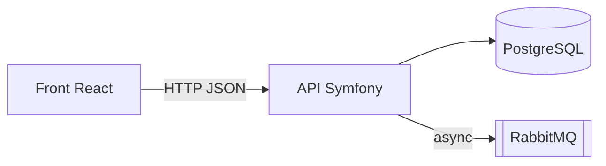

# Template figé — Cartographie d'onboarding d'une codebase

> Ce template est la **structure de référence figée** utilisée par le skill `map-codebase` du plugin `codebase-toolkit`. Toute cartographie DOIT respecter intégralement cette structure et l'ordre des sections. Une section sans objet n'est pas supprimée : elle indique explicitement « Non applicable » ou « Non observable » et pourquoi.

## Règles d'ancrage

- Toute affirmation sur le code pointe un fichier **lu** : `path/to/file.php:42` (ligne si pertinente).
- Ce qui n'a pas pu être vérifié (commande jamais exécutée, comportement déduit d'un nom) est marqué `[NON VÉRIFIÉ]`.
- Aucun secret n'est recopié : les variables d'environnement sont listées **par nom**, jamais par valeur.
- Le vocabulaire métier est repris tel quel du code (noms de modules, d'entités, de routes).

---

## Structure du document

~~~markdown
---
generated_by: codebase-toolkit/map-codebase
date: YYYY-MM-DD
perimetre: <repo entier | sous-dossier>
public: <nouvel arrivant | revue d'architecture | …>
commit: <sha court du HEAD cartographié>
---

# Cartographie — <nom du repo / périmètre>

> Résumé en 3 lignes : ce que fait l'application, pour qui, et ses grandes briques.

## 1. Stack

| Côté | Langage / runtime | Framework | Persistance | Outils qualité | Source |
|---|---|---|---|---|---|
| Back | PHP 8.x | Symfony 7.x | PostgreSQL via Doctrine | PHPUnit, PHPStan lvl N | `composer.json` |
| Front | TS 5.x | React 18 + Vite | — | Vitest, ESLint | `package.json` |
| Infra | Docker | — | — | — | `docker-compose.yml` |

## 2. Démarrage rapide

Commandes **telles que trouvées** dans le repo (Makefile, scripts, README, CI) :

| Besoin | Commande | Source |
|---|---|---|
| Installer | `make install` | `Makefile:12` |
| Lancer | `docker compose up -d` | `README.md:30` |
| Tester (back) | `make test` | `Makefile:20` |
| Tester (front) | `pnpm test` | `package.json` |
| Analyse statique / lint | … | … |

Pré-requis (versions d'outils, accès, fichiers `.env.local` à créer…).

## 3. Architecture

Description courte du style d'architecture (DDD / hexagonal, MVC classique, CQRS, monorepo…) **constaté**, pas revendiqué.

## 4. Modules

| Module | Rôle métier (1 ligne) | Chemin(s) | Points d'entrée | Dépend de |
|---|---|---|---|---|
| Souscription | … | `src/Souscription/` | `POST /api/souscriptions` | Client, Paiement |

## 5. Flux principaux

3 à 6 flux structurants, chacun en 3-5 lignes : déclencheur → étapes clés → effet final, avec les fichiers d'entrée.
> Pour le détail pas à pas d'un flux : `/codebase-toolkit:trace-flow <point d'entrée>`.

## 6. Conventions

### Back
Bloc « Format de synthèse » de `symfony-pattern-checklist.md`, puis les conventions notables avec un fichier exemple chacune.

### Front
Bloc « Format de synthèse » de `react-pattern-checklist.md`, puis les conventions notables avec un fichier exemple chacune.

## 7. Tests

Où sont les tests, de quels types, comment les lancer, fixtures / factories, ce qui est peu ou pas couvert (constat, sans note).

## 8. CI/CD & déploiement

Pipelines (fichiers et jobs), environnements, mode de déploiement, feature flags, variables d'environnement **par nom** et services externes appelés.

## 9. Glossaire métier

| Terme | Définition (déduite du code) | Où le voir |
|---|---|---|

## 10. Pièges connus & zones de dette

Points d'attention repérés pendant la cartographie (couplages surprenants, code mort apparent, TODO/FIXME structurants, conventions contradictoires). Constat court, ancré.
> Pour un diagnostic complet du back : `/codebase-toolkit:audit-codebase`.

## 11. Limitations

Ce qui n'a pas été couvert (sous-dossiers ignorés, stack hors périmètre des spécialistes, commandes non exécutées) et pourquoi.
~~~

---

## Anti-patterns à NE PAS reproduire

- ❌ Section supprimée parce qu'elle est vide, au lieu d'être marquée « Non applicable / Non observable ».
- ❌ Architecture recopiée du README sans vérification dans le code.
- ❌ Commande de démarrage inventée (« probablement `npm start` »).
- ❌ Valeur de variable d'environnement ou secret recopié.
- ❌ Jugement de qualité noté (« code propre », « 7/10 ») : la cartographie décrit, l'audit évalue.
