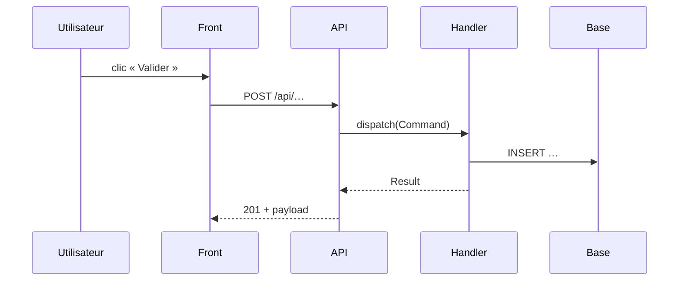

# Template figé — Traçage d'un flux de bout en bout

> Ce template est la **structure de référence figée** utilisée par le skill `trace-flow` et l'agent `flow-tracer` du plugin `codebase-toolkit`. Tout traçage DOIT respecter intégralement cette structure et l'ordre des sections.

## Règles de traçage

- **Chaque étape a été lue.** Une étape figure dans le tableau uniquement si le fichier correspondant a été ouvert et la ligne vérifiée.
- **`[RUPTURE]`** marque tout endroit où la chaîne ne peut pas être suivie avec certitude : appel dynamique (service résolu à l'exécution, `$bus->dispatch()` vers plusieurs handlers possibles, event avec plusieurs listeners), code hors du repo (librairie, service externe), configuration ambiguë. La rupture indique ce qui est connu, ce qui ne l'est pas, et comment lever le doute.
- **Un seul scénario par traçage** (nominal, ou une branche d'erreur précise). Les autres branches sont résumées en section 6.
- **Couches** utilisées dans le tableau : `FRONT`, `API`, `APPLICATION`, `DOMAIN`, `INFRA`, `ASYNC`, `EXTERNE`. Choisir la couche qui correspond au rôle du fichier dans le projet tracé.

---

## Structure du document

~~~markdown
---
generated_by: codebase-toolkit/trace-flow
date: YYYY-MM-DD
point_entree: <route | composant | commande | message>
scenario: <nominal | erreur : …>
profondeur: <frontière du repo | appels sortants décrits>
commit: <sha court>
---

# Flux — <nom du flux en langage métier>

## 1. Résumé
Une phrase : déclencheur → effet final observable.

## 2. Point d'entrée
- **Type** : route HTTP / composant front / commande console / message Messenger
- **Identifiant** : `POST /api/souscriptions` · `SouscriptionForm` · `app:import-clients` · `ValiderDossierCommand`
- **Fichier** : `path/to/entry.php:42`
- **Déclenché par** : action utilisateur, cron, autre service…

## 3. Diagramme de séquence

## 4. Étapes

| # | Couche | Fichier:ligne | Rôle | Données entrée → sortie |
|---|---|---|---|---|
| 1 | FRONT | `assets/…/Form.tsx:58` | Soumet le formulaire | `FormValues` → `POST` body |
| 2 | API | `src/…/Processor.php:31` | Route vers la commande | DTO → `Command` |

## 5. Effets de bord

| Type | Détail | Fichier:ligne |
|---|---|---|
| Écriture base | table, opération | … |
| Event / message émis | nom, sync / async, consommateurs connus | … |
| Appel externe | service, endpoint | … |
| Cache / session / fichier | … | … |

Préciser la **frontière transactionnelle** observée (où commence et finit la transaction) ou « Non observable ».

## 6. Branches d'erreur

| Condition | Exception / erreur | Réponse (code HTTP, message) | Traitement côté front | Fichier:ligne |
|---|---|---|---|---|

## 7. Points d'attention

Constats ancrés : requêtes N+1, appels synchrones lourds ou externes dans la requête, absence de transaction, validation dupliquée ou manquante, et chaque `[RUPTURE]` avec la façon de la lever.

## 8. Fichiers lus

Liste des fichiers ouverts pendant le traçage (pour vérification et pour reprendre le traçage plus tard).
~~~

---

## Anti-patterns à NE PAS reproduire

- ❌ Étape déduite d'un nom de classe sans ouvrir le fichier.
- ❌ Handler « probable » choisi sans le signaler en `[RUPTURE]` quand plusieurs candidats existent.
- ❌ Mélanger plusieurs scénarios dans le même tableau d'étapes.
- ❌ Diagramme de séquence qui contient des participants absents du tableau (ou l'inverse).
- ❌ Recommandation de refacto : le traçage décrit, il ne corrige pas.
